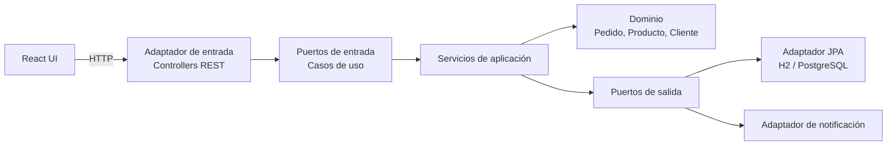

# Gestión de pedidos — Arquitectura Hexagonal

Aplicación web con **Spring Boot** (backend) y **React + TypeScript** (frontend).
Permite registrar clientes y productos, crear pedidos, confirmarlos (descuenta stock y notifica) y cancelarlos (repone stock).

## Cómo ejecutarlo

Requisitos: Java 17+, Node 18+.

**Backend** (terminal 1):

```powershell
cd backend
.\mvnw.cmd spring-boot:run
```

Queda en http://localhost:8080 con base de datos H2 en memoria y datos de ejemplo.

**Frontend** (terminal 2):

```powershell
cd frontend
npm install
npm run dev
```

Abre http://localhost:5173

**Pruebas del backend:** `cd backend` y `.\mvnw.cmd test`

**PostgreSQL (opcional):** `docker compose up -d` y luego
`.\mvnw.cmd spring-boot:run "-Dspring-boot.run.profiles=postgres"`

## API REST

| Método | Ruta | Descripción |
|---|---|---|
| GET / POST | `/api/clientes` | Listar / crear clientes |
| GET / POST | `/api/productos` | Listar / crear productos |
| GET / POST | `/api/pedidos` | Listar / crear pedidos |
| GET | `/api/pedidos/{id}` | Consultar un pedido |
| POST | `/api/pedidos/{id}/confirmar` | Confirmar (descuenta stock) |
| POST | `/api/pedidos/{id}/cancelar` | Cancelar (repone stock si estaba confirmado) |

Errores: `404` recurso no existe, `409` stock insuficiente o estado inválido, `400` datos inválidos.

## Arquitectura



```
backend/src/main/java/com/pedidos/
├── domain/            reglas de negocio puras (sin Spring ni JPA)
├── application/
│   ├── port/in/       casos de uso (interfaces)
│   ├── port/out/      repositorios y notificaciones (interfaces)
│   └── service/       implementación de los casos de uso
└── infrastructure/
    ├── adapter/in/web/        controllers, DTOs, manejo de errores
    ├── adapter/out/persistence/   entidades JPA, repositorios, mappers, adaptadores
    ├── adapter/out/notification/  notificación por log
    └── config/        conexión de casos de uso y puertos (BeanConfig)

frontend/src/
├── domain/            modelos y puertos (interfaces de repositorio)
├── application/       hooks que implementan los casos de uso
├── infrastructure/    cliente HTTP y repositorios concretos
└── ui/                páginas y componentes
```

**Regla clave:** las dependencias apuntan hacia adentro. `domain` no importa nada de `application` ni de `infrastructure`.

## Principios SOLID

| Principio | Dónde se evidencia |
|---|---|
| **S** Responsabilidad única | Un caso de uso por clase; los controllers solo traducen HTTP; los mappers solo convierten |
| **O** Abierto/cerrado | `PoliticaDescuento` es una interfaz: se agregan políticas nuevas sin modificar `Pedido` |
| **L** Sustitución de Liskov | Cualquier implementación de un puerto (JPA, mock en pruebas) es intercambiable |
| **I** Segregación de interfaces | Puertos pequeños: `ConfirmarPedidoUseCase`, `CancelarPedidoUseCase`, etc. |
| **D** Inversión de dependencias | Los servicios dependen de puertos; `BeanConfig` inyecta los adaptadores |

## Código limpio

- Nombres que expresan intención, métodos cortos de un solo nivel de abstracción.
- Validaciones dentro del dominio (`Producto`, `Cliente`, `Pedido`) y excepciones propias.
- Constantes con nombre (`UMBRAL`, `PORCENTAJE`), sin números mágicos.
- Registros inmutables (`record`) para DTOs y comandos.

## Refactorizaciones sugeridas (para documentar en commits `refactor:`)

1. Extraer el `orElseThrow(RecursoNoEncontradoException)` repetido en los servicios a un método reutilizable.
2. Agregar una segunda `PoliticaDescuento` (por cliente frecuente) y elegirla por configuración.
3. Reemplazar la notificación por log con un adaptador de correo real.
